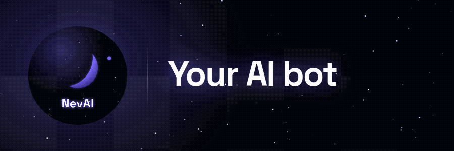
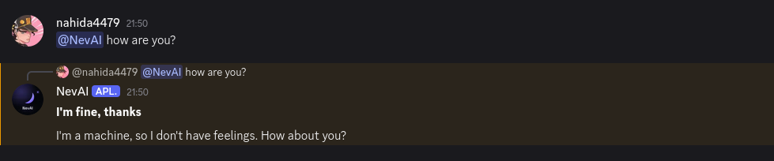
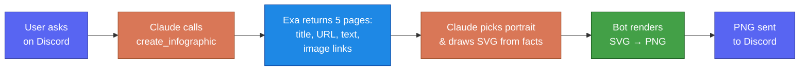
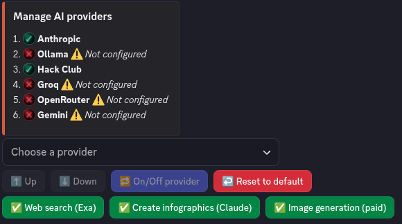

# NevAI
<a href="https://discord.com/invite/CttU24eg3F">
    
</a>


<p align="center" style="text-align: center; font-weight: bold;">A Discord bot that lets admins set an AI channel per server, mention it and it responds using free AI models and Exa.ai (optional), remembering the last 15 messages for context.</p>

<div align="center">

<a href="https://discord.com/oauth2/authorize?client_id=1544417524613910628&permissions=17179995200&integration_type=0&scope=bot"></a>

<a href="./LICENSE"></a>

<a href="https://discord.com/invite/CttU24eg3F"></a>
</div>

# Features

- Only the Discord server administrator can use `/ai`, `/ai_settings`, `/language`, and `/logs`.
- The bot responds using the AI models listed below.
- The bot supports vision models (image understanding).
- Responses are limited to 1500 characters.
- Pre-built Docker image available.
- Custom success and error emoji.
- The bot reacts with an emoji when responding in a Discord chat.
- The server administrator can set a custom AI prompt.
- Multi-language support ([add your own language](./CONTRIBUTING.md)).
- The bot saves the last 15 messages for chat context.
- Live logs support (`/logs` command).
- The bot can use custom Discord server emoji.
- Responds using `Exa.ai`.
- Generate infographic (only Anthropic models).
- Running local models using Ollama.
- Generate and edits images.

# How to use?
1. [Add bot](https://discord.com/oauth2/authorize?client_id=1544417524613910628&permissions=17179995200&integration_type=0&scope=bot) and set the AI channel using the `/ai` command.
2. Mention the bot, then ask your question.



3. You can customize the bot's options using [administrator commands](#administrator-commands) (server administrator only).

# AI models list (free models)

**Gemini**
```yaml
gemini-2.5-flash
gemini-2.5-flash-lite
```

**Groq**
```yaml
openai/gpt-oss-120b 
openai/gpt-oss-20b
```

**HackClub**
```yaml
openai/gpt-6-luna
```

**Openrouter**
```yaml
Free models (openrouter/free)
```

> [!WARNING]
> The model list may change at any time. Free models can be renamed, limited or removed by their providers.


# AI models list (paid models)

**Anthropic**
```yaml
Claude Haiku 5.5
```

## Generate image AI (paid model)

**OpenRouter**
```yaml
google/gemini-3.1-flash-lite-image
```

**Gemini**
```yaml
gemini-3.1-flash-lite-image
```

---

# Ollama (local models)
Ollama is detected automatically. Make sure it is running and has at least one chat model downloaded (e.g. `ollama pull gemma3:12b`). By default, the bot looks for Ollama at `http://127.0.0.1:11434` if no address is set in `.env` under `OLLAMA_URL=`. If no AI model is set under `OLLAMA_MODEL=` in `.env`, the first detected model is used. Embedding models are skipped.

> [!WARNING]
> Internet search and infographic generation are not available when using Ollama.


## Models web search ([Exa.ai](https://exa.ai/))

The model decides for itself whether it wants to use Exa.ai. When the model uses Exa.ai, information from the internet is returned. The model uses this information to respond in the Discord chat. When the model decides it doesn’t need to use Exa.ai, it won’t. If you don’t add an EXA_API token, the bot will continue to function, but it will not search for information on the web. Exa returns images too.

## How infographic generation works (Required Anthropic model and Exa.ai)




If both `ANTHROPIC_API` and `EXA_API` are set in `.env`, every provider __except Gemini, Ollama and vision models__ gets access to the `create_infographic` tool. The tool generates custom infographics based on the data returned by `Exa`. The infographic itself is always **drawn by an Anthropic model** (tested with Haiku 5.5).

For example, if you are currently using the `Hack Club provider`, its model (as long as it supports tools) can request an infographic. The bot then searches `Exa` for facts and images, and the `Anthropic model` picks the character portrait and draws the infographic. The finished image is attached to the **reply on Discord**, and the main model only receives a confirmation that the infographic was created, so it can add a short message.


# Image generation (OpenRouter or Google Gemini, paid)

The `generate_image` tool generates new images and edits images sent by the user. The request is sent to the model defined in `providers_list.js`. To use image generation, you need at least one of the following API keys set in `.env` under `GENERATE_IMAGE_API=`. The provider is detected automatically from the key you paste:

- **OpenRouter** (key starts with `sk-or-`)
- **Google Gemini** (key starts with `AIza`)

The models used for each provider are defined in `providers_list.js`:
```js
image: {
    openrouter: 'google/gemini-3.1-flash-lite-image', // Paid
    google: 'gemini-3.1-flash-lite-image',            // Paid
},
```

> **Warning:** image generation is a paid feature. Every generated or edited image is charged to the API key owner. Set a spending limit on your key before enabling it.

# Administrator commands

| **Commands** | **Description** |
|---|---|
| `/ai` | Set the channel where the AI will respond to mentions.|
| `/ai_settings` | Open the settings panel to customize the AI prompt, AI providers and reaction emoji. |
| `/language` | Change the bot's response language. |
| `/logs` | Set the channel where AI response logs will be sent. |
| `/help` | List of commands in embed format |

## Manage AI providers (using /ai_settings)

Managing AI providers lets you set which provider answers first by changing the order in the list. You can also enable or disable each provider. If a provider's token has not been added to `.env`, the **⚠️ Not configured** label is shown. In the AI provider settings you can also enable or disable [web search with Exa](#models-web-search-exaai), [infographic generation](#how-infographic-generation-works-required-anthropic-model-and-exaai) (which uses Exa and Claude models), and [image generation or editing](#image-generation-openrouter-or-google-gemini-paid) with Gemini models.



# Requirements

#### At least one of the listed AI providers:

 [Groq](https://console.groq.com/keys) **|**
 [Gemini](https://aistudio.google.com/api-keys) **|**
 [HackClub](https://ai.hackclub.com/keys) **|**
 [OpenRouter](https://openrouter.ai) **|**
 [Anthropic](https://platform.claude.com) **|**
 [Ollama](https://ollama.com) (Ollama running locally, no API key needed)

You'll also need a [Discord Application](https://discord.com/developers/applications) to get __your bot token__ and optionally an [Exa.ai](https://exa.ai/) API key (so the models can search for information on the internet).

## Env

```bash
GROQ_API=
GEMINI_API=
HACKCLUB_API=
OPENROUTER_API=
EXA_API=
DISCORD_API=
ANTHROPIC_API=
DEBUG_MODE= #true/false
OLLAMA_MODEL= # By default, the first model returned by Ollama
OLLAMA_URL= # Default http://127.0.0.1:11434
GENERATE_IMAGE_API= # Paid google model
```

> [!NOTE]
> `DEBUG_MODE` adds an advanced logging option to the `debug.log` file.


# Running

## Docker with install.sh

```bash
curl -sSL https://raw.githubusercontent.com/Nahida4479/NevAI-Bot/main/install/install.sh | bash
```

## Docker manual (no automatic updates)

```bash
mkdir NevAI
cd NevAI
curl -fsSL -o .env https://raw.githubusercontent.com/Nahida4479/NevAI-Bot/main/example/env.example 
nano .env
chmod 600 .env
touch data.json
docker run -d --env-file .env -v $(pwd)/data.json:/NevAI/data.json --network host --name nevai --restart unless-stopped ghcr.io/nahida4479/nevai:latest
```

# License 
Released under the [MIT License](./LICENSE) © 2026 [Nahida4479](https://github.com/Nahida4479).
Free to use, modify and share, as long as the license notice is kept. Provided "as is", without warranty.